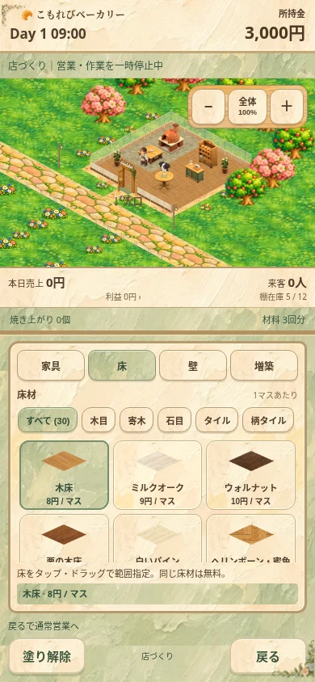
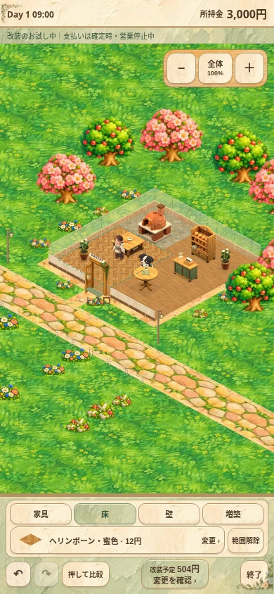
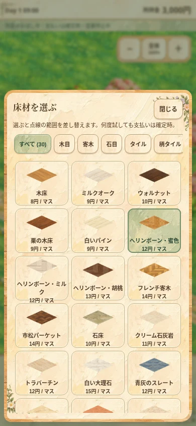
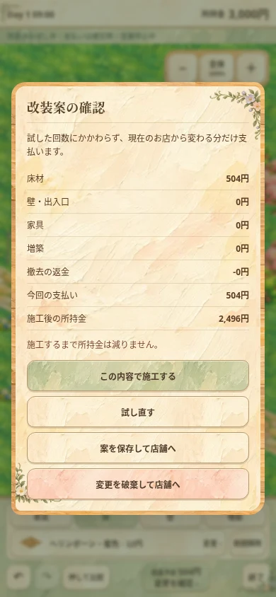

# お店を見ながら、支払う前に試す改装

床・壁・出入口・家具・増築をひとつの改装案にまとめます。営業を止めて自由に仮適用し、確認画面から一括施工します。試用中は所持金・収支・確定済み店舗の保存を変更しません。

## 操作

- 店づくりでカテゴリを選び、見本つきの「変更」から素材帳を開きます。素材帳は店舗のレイアウトを押し縮めず、一覧だけをスクロールします。
- 床はタップ・ドラッグ、壁は境界、壁紙変更は壁本体を選びます。直前の範囲は点線で保持し、素材を選び直すと同じ範囲を差し替えます。「範囲解除」で次の場所を選べます。
- 家具は選んで空き床へ仮置き。既存家具はつかんで移動・回転・撤去できます。増築は方向を選び「増築を試す」で案へ追加します。
- 戻す・やり直すは最大100操作。比較ボタンは押している間だけ変更前を描画します。
- 「変更を確認」「終了」から、施工・試し直す・案を保存して店舗へ・変更を破棄して店舗へ、を選べます。

## 支払いと保存

所持金が足りなくても試せます。確認時に不足額、通路・入口・作業面・人との衝突、必須設備と営業資金、増築可能な営業フェーズを再検証します。資金不足では施工だけを止めます。

費用は最初の店舗と最終案との差分です。柄の比較や貼り直しを途中で繰り返しても重複請求しません。元の素材に戻した分は無料です。仮置きした家具・壁を消しても返金を発生させず、元からあった設備・壁の撤去だけを従来の半額返金で精算します。増築は追加面積×80円。奥増築による既存床・壁・家具の移設は施工費を発生させません。

通常セーブ `bakery_web_v1` と保存バージョン7は維持。試用中に自動保存・ページ非表示・再読み込みが発生しても、通常セーブには改装前の店舗と人の位置を書きます。案は別の `bakery_renovation_v1` に保存し、次の店づくりで再開します。資金が増えても再開できます。店舗自体が変わった場合は古い案を適用せず通知します。初期化で案も消します。保存できないときは通知し、「案を保存して店舗へ」では画面を閉じません。

動作デモは通常セーブと改装案のどちらにも読み書きしません。

## 画面

絵本の紙・木・セージ色と既存素材を保持。改装中は営業HUDを畳み、カテゴリ・選択中の見本・履歴・合計金額・終了だけを常設します。横画面では操作を右側へ移します。

| 変更前 | 仮適用中（所持金は3,000円のまま） |
| --- | --- |
|  |  |

| 素材帳 | 一括精算前の確認 |
| --- | --- |
|  |  |

[小型縦画面](review/trial-320.webp) · [横画面](review/trial-landscape.webp)

画像は実ブラウザーのローカル版です。公開版・スマホ実機の確認とは区別します。

## 実装と検証

- `renovation.js`：作業コピー、履歴、元の配置との比較、差分見積もり、案の独立保存、一括精算。
- `experience.js`／`experience.css`：素材帳、範囲の再利用、確認画面、改装中の表示。
- `index.html`／`interior.js`：仮適用時の支払いを抑制し、通常セーブ・描画・既存の経路判定へ接続。

```
node tools/tests/renovation.cjs
node tools/tests/experience.cjs
node tools/tests/startup.cjs
node tools/tests/starter-shop.cjs
node tools/tests/interior.cjs
node tools/tests/workflow.cjs
```

新しい改装受け入れ13項目、画面導線9項目、開業保護5項目、新規店舗7項目、内装エンジン23項目・増築後3営業日、営業20項目・3営業日を確認。390×844／320×568／844×390で画面幅のはみ出しがなく、素材帳の開閉で店舗canvasの寸法が変わらず、カテゴリごとに店舗の表示高さが画面の56%以上あることも確認しました。旧内装UIテストの入口 `interior-experience.cjs` は新しい改装受け入れテストへ接続しています。`interior.cjs` は基礎エンジンを直接指定する回帰、新UIの公開操作は `renovation.cjs` が担当します。
