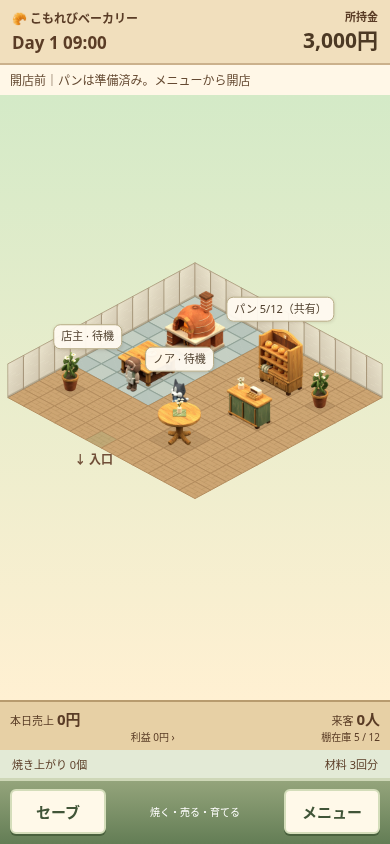
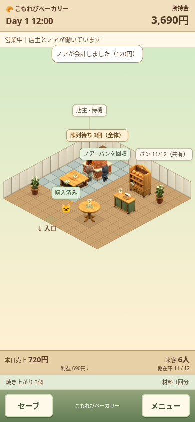

# 営業できる初期店舗

2026-10-19。新規開始時点から「パンを焼く・売る・店を育てる」が伝わる、小さなベーカリーを用意した。

- 店舗は12×12。奥側の漆喰壁、石床の作業場、木床の売場で用途を分ける。
- オーブン・調理台・パン棚・レジを配置済み。小テーブル1点と植木2点で売場を整える。テーブルは装飾で、着席サービスの追加ではない。
- 所持金3,000円、棚のパン5個、材料3回分。メニューから開店すると、スタッフが製造・陳列・会計を進める。
- 開店前なので配置変更・商品開発・増築も可能。初期設備は支給資産として扱い、当日の購入費と利益を歪めない。

有効な既存セーブは空店舗を含め維持する。新規開始、壊れた保存からの復帰、設定で確認して初期化した場合だけ新セットになる。初期化を取り消すと保存と画面を維持する。動作デモは従来の別条件・保存非変更を保つ。

## 検証

`node tools/tests/starter-shop.cjs`。小画面320×568／390×844と横画面844×390、設備の非重複、126マスの通行可能セルと全サービスへの経路、初日の製造・販売・閉店、途中再読込、旧セーブ、初期化と取消、不正JSONからの復帰を確認。

[検証結果](validation.json)。最初の180分で6件販売し、製造・窯入れ・回収・陳列・仕入れ・会計を観測。タイマーを止めてゲーム内時間を進める自動確認で、実時間のプレイ録画ではない。

